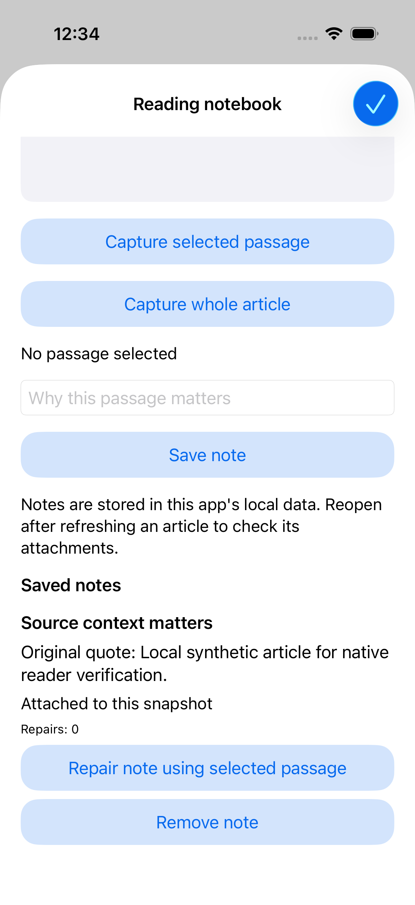

# Feedmark

A native iOS reading notebook built on the complete NetNewsWire app. Save why an article matters, keep the original quotation, and check whether that passage still has a defensible attachment when the article changes.

The upstream reader supplies feeds, article rendering, accounts and SQLite storage. This fork adds the Swift/UIKit notebook, quote descriptors and resolver, atomic local note archive, explicit repair history and native verification tooling. Original MIT notices and Git history are retained. [Unmodified upstream README](README.upstream.md).

## Workflow

1. Open an article and tap **Reading notebook** in its toolbar.
2. Select a passage and capture it, or capture a short whole article. Write your note and save.
3. Reopen the app to recover the note. After refreshing an article, reopen its notebook to check attachment status against the new text.
4. If the passage is missing or ambiguous, the original quote remains visible. Select a new passage and explicitly repair the note. Prior descriptors remain in its history.

The sheet freezes the rendered text it opened with. It never silently includes later background changes. The resolver first checks the original snapshot digest and position. After a change it checks exact quotation/context evidence; multiple supported matches remain ambiguous. Short or changed-context matches can remain unresolved. This favors a visible unresolved note over an unjustified attachment, but does not guarantee semantic identity.

Actual simulator capture after saving a note and relaunching the app.

## Run and verify

The app requires macOS, Xcode 26.3 and an installed iOS simulator. It runs without a news-service account using NetNewsWire's local feeds. This repository's work is scoped to iOS; the upstream macOS app is retained.

Use **Feedmark checks** in [Actions](https://github.com/STEVVVU/feedmark-ios/actions/workflows/feedmark-native.yml). Push CI builds the unsigned app, runs the iOS test plan, pinned SwiftLint and the compiler warning gate, then shuts down its owned simulator and fixture server. To run the separate native UI acceptance path, dispatch the workflow with `drive_native=true`. It drives Maestro against controlled loopback RSS and retains screenshots and actual app-container data. Build-only success does not establish UI acceptance. No model/provider key or signing portal is involved.

For local source work, use the `NetNewsWire-iOS` scheme and see the [verification skill](.agents/skills/verify-feedmark/SKILL.md) for the exact unsigned build configuration, test commands and maintained feature map.

## Evidence and limits

The [native feature check](https://github.com/STEVVVU/feedmark-ios/actions/runs/39520091249) passed all 20 iOS tests, pinned SwiftLint and the compiler warning gate. The actual reader, whole-article capture, note input/save and terminate/relaunch flows passed. The sandbox archive retained the exact note and original quote bytes after relaunch; the native screenshots were inspected. All four cleanup checks passed.

The expanded content-change flow remains pending. [Run39530261297](https://github.com/STEVVVU/feedmark-ios/actions/runs/39530261297) fetched the changed RSS source after the fixture declared `max-age=1`, but the timeline retained its old summary. The formatter cached summaries by article identity without checking changed body text. The cache now retains the source body with each summary and replaces that entry when content changes; three deterministic regression cases cover changed content, account isolation and missing bodies. [Run39538118708](https://github.com/STEVVVU/feedmark-ios/actions/runs/39538118708) passed all 23 Swift tests, pinned SwiftLint, the unsigned app build and the warning gate after adding the test target’s direct Articles linkage. All four cleanup checks passed. Full native changed-content, repair and removal acceptance remains unverified. Native UI checks are optional while the current delivery scope focuses on code and build verification.

Notes use an app-sandbox JSON archive written atomically by one main-actor store. No sync, encryption, backup exclusion or cross-process writer is claimed. Bounds are 200 notes, 20 repairs per note, 100,000 UTF-16 units of article text and 4,000 units per captured quote. A failed or corrupt archive read does not reset the existing file. A changed article can deliberately leave a quote unresolved.

Native partial-selection gestures, content-change paths, repair/removal and broader device/accessibility coverage still need real-product evidence. No real-user study, production operation, full dependency-security audit or research-quality recovery rate is claimed.

## Research and course connection

[Robust Intra-document Locations, Phelps and Wilensky, WWW2000](https://www.ra.ethz.ch/cdstore/www9/312/312.html) motivates retaining redundant location evidence and making uncertainty visible. This implementation uses a bounded quote/context policy; it does not reproduce the full UID/tree-walk/Multivalent system.

[Stanford CS249B's historical advanced project brief](https://web.stanford.edu/class/cs249b/projects.html) provides an adjacent design/implementation/experiment structure. It is not a mobile assignment or a claim of course completion. The eleven-edit controlled comparison ran on the native SDK.

| Policy | Correct | Incorrect or unsupported | Unresolved |
| --- | ---: | ---: | ---: |
| Original offset | 2 | 8 | 1 |
| First quotation match | 4 | 3 | 4 |
| Conservative descriptors | 4 | 0 | 7 |

Three of the conservative policy's unresolved cases still had a surviving target. The other four had no justified unique target. These hand-authored fixtures show an explicit recovery tradeoff, not a real-world recovery rate. See [the declared protocol](docs/feedmark/attachment-evaluation.md) and [recorded results](docs/feedmark/attachment-results.json).

Swift, UIKit, WebKit and CryptoKit implement the notebook alongside the upstream SQLite-backed reader. Python and pinned Maestro/SwiftLint releases support repeatable verification. The upstream base is [Ranchero-Software/NetNewsWire at 94032d95](https://github.com/Ranchero-Software/NetNewsWire/tree/94032d95fe04a05d44591450234c3c5da0a40842).
